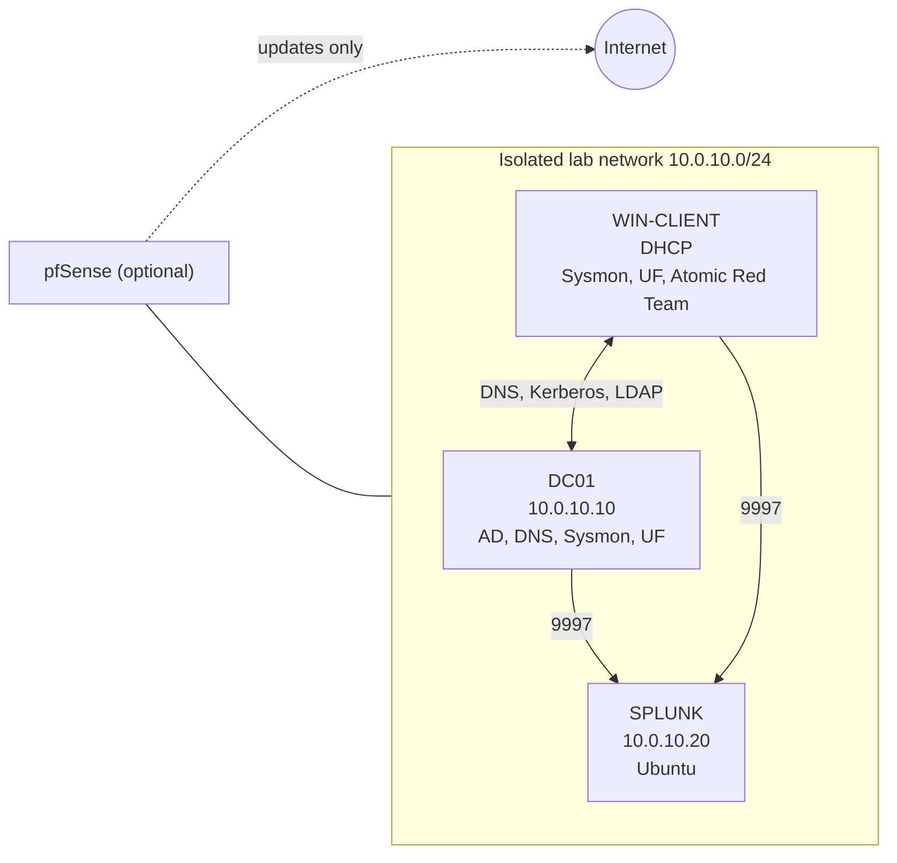

# Detection Engineering Lab

> One-line summary: an isolated Active Directory lab where I generate adversary behavior with Atomic Red Team, detect it in Splunk, and automate the test-and-validate loop with PowerShell.

**Status:** In progress | **Last updated:** YYYY-MM-DD

## Goals

- Build a repeatable lab: attack, log, detect, validate
- Write detections mapped to MITRE ATT&CK, with the SPL and the test that proves each one fires
- Automate the loop with PowerShell (run test, wait, query Splunk, report pass/fail)
- Document what broke and why (see [Troubleshooting log](#troubleshooting-log))

## Architecture

#



### Components

| VM | OS | vCPU / RAM | IP | Role |
|---|---|---|---|---|
| DC01 | Windows Server 2022 | 2 / 4 GB | 10.0.10.10 (static) | AD DS, DNS |
| WIN-CLIENT | Windows 10/11 | 2 / 4 GB | DHCP | Domain-joined target, Atomic Red Team |
| SPLUNK | Ubuntu Server | 4 / 8 GB | 10.0.10.20 (static) | Splunk Enterprise, indexer and search |
| pfSense (optional) | pfSense | 1 / 1-2 GB | 10.0.10.1 | Gateway, controlled egress |

**Host:** Desktop, VMware Workstation, XX GB RAM

### Design decisions

- **Why VMware Workstation:** TODO
- **Why an isolated network:** TODO (attacker tooling and malware-like behavior stay off the home LAN)
- **Why Sysmon + Windows Security logs:** TODO (which config, and why)
- **Why pfSense / why not:** TODO

## Safety and isolation

- No bridged adapters. Lab traffic stays on the host-only network
- Internet access only through the gateway or a temporary NAT adapter, off during attack tests
- Shared folders, clipboard, and drag-and-drop disabled on all VMs
- Clean-baseline snapshots taken before any attack, and before touching the DC
- Defender exclusions applied only to the lab client's test folder (documented below)

## Build log

Screenshots live in `docs/screenshots/`.

1. **Domain controller** — static IP, AD DS, DNS, OUs, test users, groups. *Screenshot / notes:* TODO
2. **Windows client** — DNS pointed at DC, domain join, domain login. TODO
3. **Splunk server** — static IP, receiving on 9997, indexes created. TODO
4. **Sysmon and Universal Forwarders** — config used, inputs.conf, target index. TODO
5. **Verification** — searches confirming Security and Sysmon events arrive from both hosts. TODO
6. **Baseline snapshots** — names and dates. TODO

## Log ingestion

| Source | Collected via | Index | Sourcetype | Verified (date) |
|---|---|---|---|---|
| Windows Security | UF | TODO | TODO | |
| Sysmon | UF | TODO | TODO | |
| PowerShell logging (4104) | UF | TODO | TODO | |

Verification search used:

```spl
index=* | stats count by host, sourcetype
```

## Detections

Each detection has its own file in `detections/`. Template:

```
Name:
ATT&CK technique:
Atomic test (GUID):
Log source / event IDs:
Logic (SPL):
Expected result:
Observed result:
False positives / tuning notes:
Status: draft | validated | tuned
```

| # | Technique | Atomic test | Detection | Status |
|---|---|---|---|---|
| 1 | T1059.001 PowerShell | TODO | TODO | draft |
| 2 | TODO | TODO | TODO | |
| 3 | TODO | TODO | TODO | |

## Automation (PowerShell)

Goal: one script runs an Atomic test, waits for ingestion, queries Splunk, and reports whether the expected detection fired.

```
scripts/
  Invoke-DetectionTest.ps1   # run atomic -> wait -> query Splunk -> pass/fail
  Get-SplunkResults.ps1      # wrapper around the Splunk REST API
  Reset-Lab.ps1              # cleanup / revert helper
```

Planned flow:

1. Run `Invoke-AtomicTest` for a technique on the client
2. Wait for forwarder latency
3. Query Splunk for the detection logic over the test window
4. Output a result record (technique, test, fired yes/no, time to detect)
5. Write results to `results/` (CSV or JSON)

## Results

| Technique | Test | Detected? | Time to detect | Notes |
|---|---|---|---|---|
| | | | | |

Coverage summary: TODO (techniques tested vs. detected, gaps found)

## Troubleshooting log

What broke and why. Short entries, newest first.

| Date | Symptom | Root cause | Fix |
|---|---|---|---|
| | | | |

## Lessons learned

- TODO

## Next steps

- TODO

## Repository layout

```
.
├── README.md
├── docs/
│   ├── network-diagram.png
│   └── screenshots/
├── configs/        # sysmon config, inputs.conf, etc.
├── detections/     # one file per detection
├── scripts/        # PowerShell automation
└── results/
```

## References

- MITRE ATT&CK
- Atomic Red Team documentation
- Splunk documentation
- (Add your Sysmon config source)
