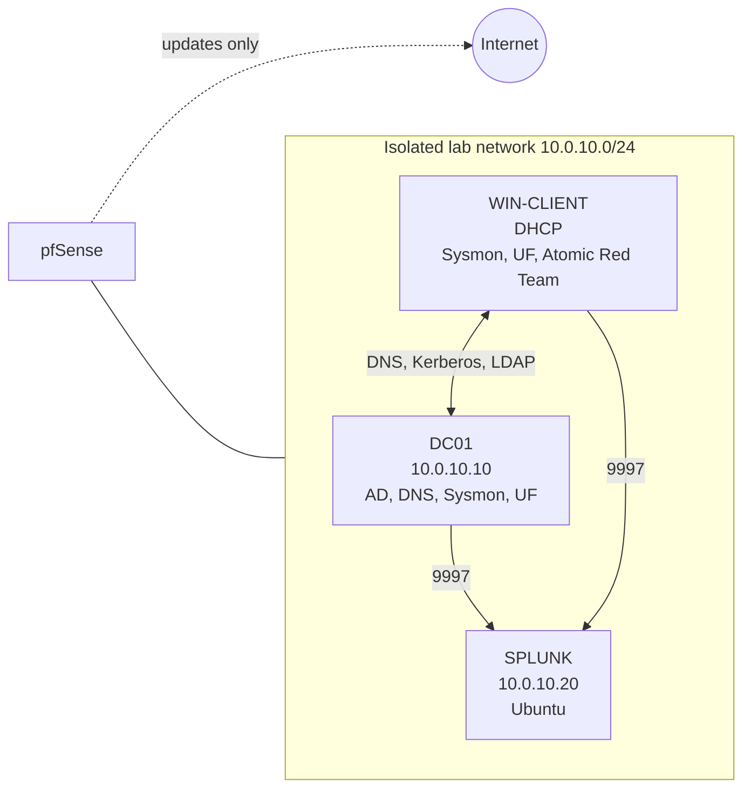

# Detection Engineering Lab

An isolated Active Directory lab where I generate adversary behavior with Atomic Red Team, detect it in Splunk, and automate the test-and-validate loop with PowerShell.

**Status:** In progress | **Last updated:** 2026-11-16

## Overview

This project is a small, self-contained enterprise environment built to practice detection engineering. A domain controller, a domain-joined Windows client, and a Splunk server run on an isolated virtual network behind a pfSense gateway. I run simulated attacks against the client, write detections for the activity they produce, and use PowerShell to check automatically that each detection fires.

## Tools

Powershell, Active Directory, Atomic Red Team, Splunk, VMware, Pfsense.

### How it works

1. **Attack:** Atomic Red Team runs a technique on the Windows client
2. **Log:** Sysmon and Windows event logs record what happened
3. **Ship:** The Splunk Universal Forwarder sends the logs to Splunk (port 9997)
4. **Detect:** A Splunk search (the detection) looks for the behavior, mapped to MITRE ATT&CK
5. **Validate:** A PowerShell script runs the test, queries Splunk, and reports whether the detection fired

## Goals

- Build a repeatable lab: attack, log, detect, validate
- Write detections mapped to MITRE ATT&CK, each with the SPL and the test that proves it fires
- Automate the test-and-check loop with PowerShell
- Document what broke and why, so the lab is reproducible

## Architecture



### Components

| VM | OS | vCPU / RAM | IP | Role | Status |
|---|---|---|---|---|---|
| pfSense | pfSense | 1 / 1-2 GB | 10.0.10.1 | Gateway, controlled egress | Planned |
| DC01 | Windows Server 2022 | 2 / 4 GB | 10.0.10.10 (static) | AD DS, DNS | Planned |
| WIN-CLIENT | Windows 10/11 | 2 / 4 GB | DHCP | Domain-joined target, Atomic Red Team | Planned |
| SPLUNK | Ubuntu Server | 4 / 8 GB | 10.0.10.20 (static) | Splunk Enterprise | Planned |

**Host:** Desktop, VMware Workstation, 32 GB RAM

## Design decisions

- **Why VMware Workstation:** It's the hypervisor I already use and know well for hosting my VMs.
- **Why an isolated network:** I want all malware-like behavior kept off my home LAN and from affecting anything outside the lab VMs.
- **Why pfSense:** It adds another layer to the environment and gives me controlled egress. I can allow updates when I need them and block outbound traffic the rest of the time, so nothing malicious can reach out.
- **Why Sysmon + Windows Security logs:** TODO (which config, and why)

## Safety and isolation

- No bridged adapters. Lab traffic stays on the host-only network
- Internet access only through pfSense, and only while updating, never during attack tests
- Shared folders, clipboard, and drag-and-drop disabled on all VMs
- Clean-baseline snapshots taken before any attack, and before touching the DC
- Defender exclusions applied only to the lab client's test folder (documented when added)

## Progress

| Milestone | Status |
|---|---|
| Network, pfSense, and DC up | Planned |
| Client domain-joined | Planned |
| Splunk receiving logs from both Windows hosts | Planned |
| First detection validated against an Atomic test | Planned |
| PowerShell automation of the test-and-check loop | Planned |

Detailed build notes, detections, results, and the troubleshooting log are kept in `docs/`, `detections/`, and `results/` as they are written.

## Repository layout

```
.
├── README.md
├── docs/           # network diagram, screenshots, build notes
├── configs/        # Sysmon config, inputs.conf, etc.
├── detections/     # one file per detection
├── scripts/        # PowerShell automation
└── results/
```

## References

- MITRE ATT&CK
- Atomic Red Team documentation
- Splunk documentation
- (Add your Sysmon config source)
