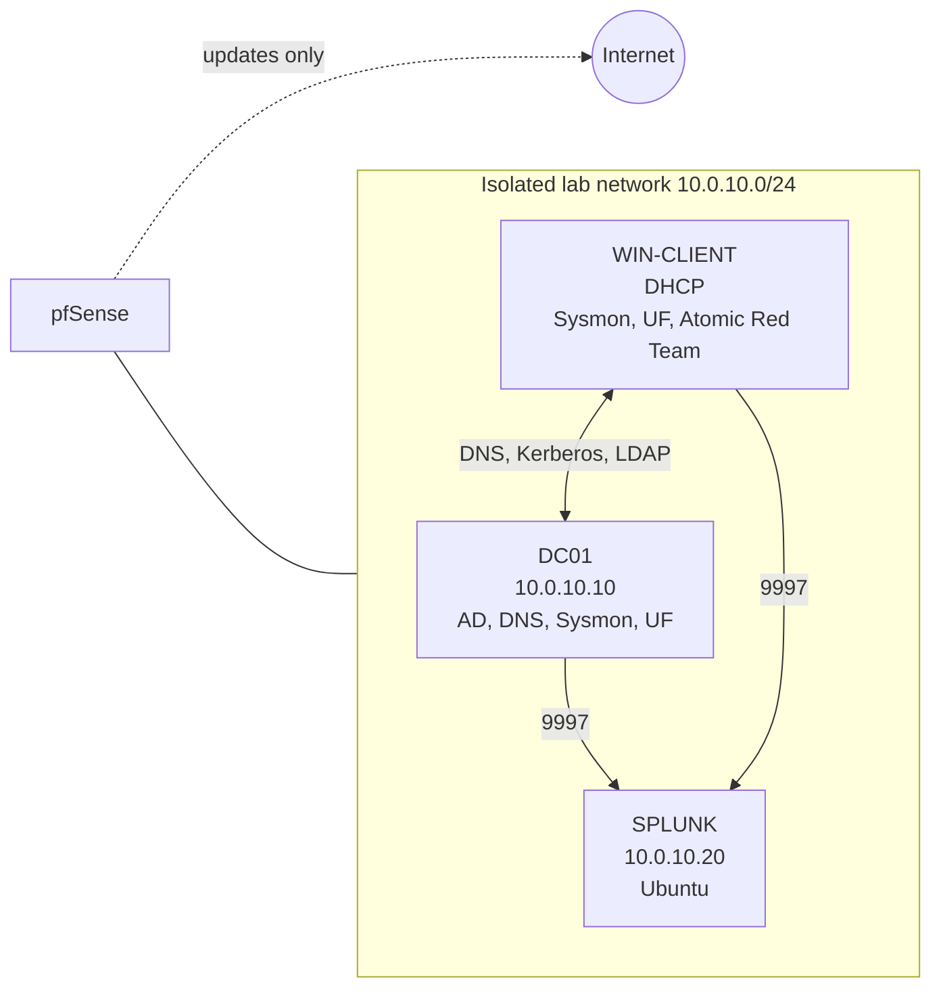

# Network Design

![diagram goes here, or paste the mermaid block]

## Overview
[1-2 sentences: what the lab network is and what it's for]

## Why the network is segmented
- **Containment:** Atomic Red Team runs real attack techniques. The lab sits on its own subnet so nothing can reach my home network or personal devices.
- **Controlled egress:** The lab can only reach the internet for [updates only]. This keeps attack activity from leaving the lab.
- **Realistic design:** Production environments separate networks by function, and this mirrors that.
- **Clean data:** Only lab traffic shows up in my logs, so detections aren't polluted by home devices.

## Addressing
| Host | IP | Role |
|---|---|---|
| pfSense | [LAN IP] | Gateway / firewall |
| DC01 | 10.0.10.10 | AD, DNS |
| SPLUNK | 10.0.10.20 | Log collection |
| WIN-CLIENT | DHCP from [who?] | Attack target |

## Key traffic
| From | To | Port / Protocol | Why |
|---|---|---|---|
| DC01, WIN-CLIENT | SPLUNK | 9997 | Forwarders ship logs |
| WIN-CLIENT | DC01 | DNS, Kerberos, LDAP | Domain authentication |
| Lab | Internet | [ports] via pfSense | Updates only |

## Notes
[Anything that went wrong or that you'd change]
