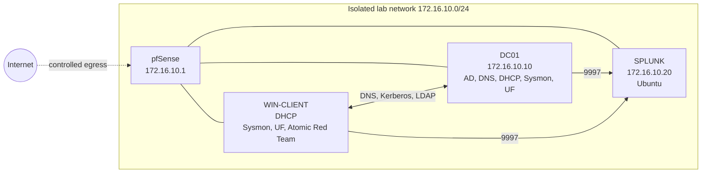

# Network Design

## Overview

The lab runs on a private virtual network so the VMs can talk to each other without touching my home LAN. In VMware Workstation:

- **`VMnet2` (host-only)** is the lab network, `172.16.10.0/24`, with VMware's DHCP turned off. DC01, WIN-CLIENT, and SPLUNK each have a single adapter, connected only to `VMnet2`.
- **`VMnet8` (NAT)** is used only by pfSense's WAN adapter, to reach the internet.
- **pfSense** has two adapters (WAN on `VMnet8`, LAN on `VMnet2`) and is the lab's only gateway. The other VMs have no direct path to the internet, so all outbound traffic goes through it.
- **My desktop** reaches the lab through the VMware host adapter on `VMnet2` (`172.16.10.2`, static), which I use for the pfSense and Splunk web interfaces. It's the one deliberate way into the lab, so I list it here and in the README's isolation section.

## Why the network is segmented

- **Containment:** Atomic Red Team runs real attack techniques. The lab sits on its own subnet so nothing can reach my home network or personal devices.
- **Controlled egress:** The lab's only way out is through pfSense. Egress is currently allowed while I build; the plan is to replace that with a rule I turn on only for updates, and block outbound traffic the rest of the time.
- **Realistic design:** Production environments separate networks by function, and this mirrors that.
- **Clean data:** Only lab traffic shows up in my logs, so detections aren't polluted by home devices.

## Addressing

| Host | IP | Role |
|---|---|---|
| pfSense (LAN) | 172.16.10.1 | Gateway / firewall |
| pfSense (WAN) | DHCP from VMware NAT | Internet access |
| DC01 | 172.16.10.10 (static) | AD, DNS, DHCP |
| SPLUNK | 172.16.10.20 (static) | Log collection |
| WIN-CLIENT | DHCP from DC01 (`172.16.10.100-200`) | Attack target |
| Host adapter (desktop) | 172.16.10.2 (static) | Management access |

## Key traffic

| From | To | Port / Protocol | Why |
|---|---|---|---|
| DC01, WIN-CLIENT | SPLUNK | TCP 9997 | Forwarders ship logs |
| WIN-CLIENT | DC01 | DNS (53), Kerberos (88), LDAP (389) | Domain authentication |
| Lab VMs | pfSense | Default gateway | All outbound traffic |
| pfSense | Internet | DNS (53), HTTP/HTTPS (80, 443) | Updates, while egress is allowed |
| Desktop | pfSense, SPLUNK | TCP 443 (pfSense GUI), TCP 8000 (Splunk web) | Management |

## Notes

- **Subnet choice:** I first planned `10.0.10.0/24` and moved to `172.16.10.0/24` to avoid overlap with `10.x` ranges common on campus networks and VPNs. The move was a precaution while I was troubleshooting, and I kept it because it's safer.
- **pfSense GUI timeout:** After setup, ping to the firewall worked but the web GUI timed out. The cause was the LAN adapter in the VM settings being left disconnected (Connect at power on was unticked). Lesson: check VM adapter state before suspecting the network.
- **Status:** egress toggle rule not yet configured.
